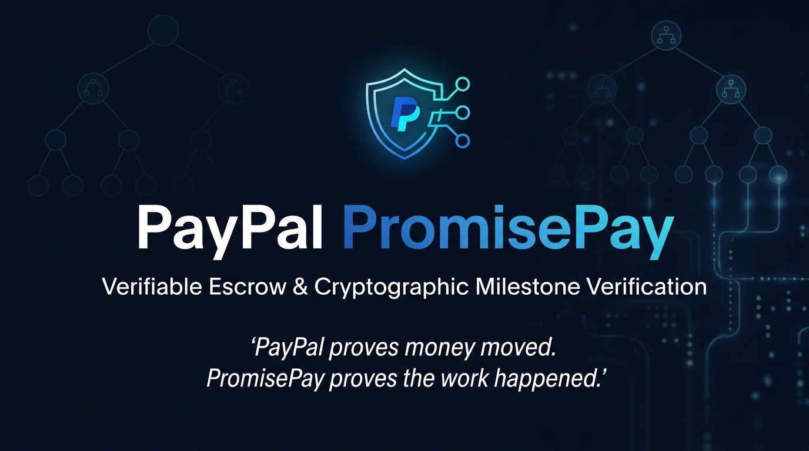
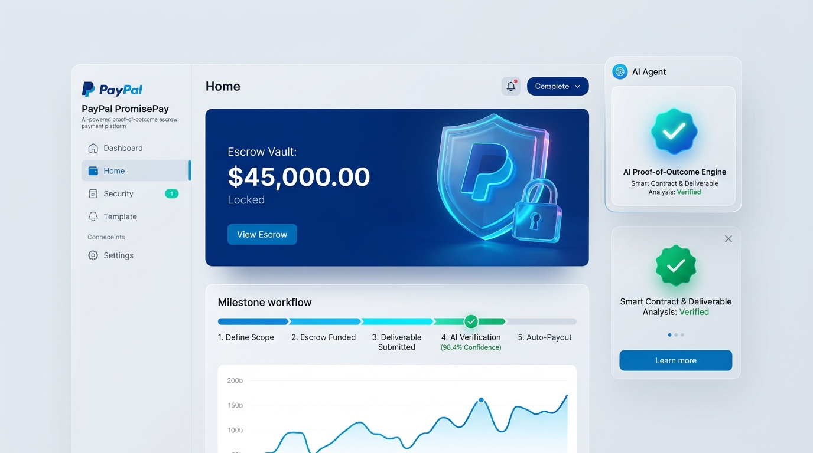
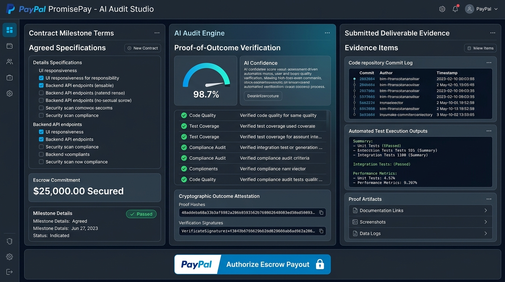
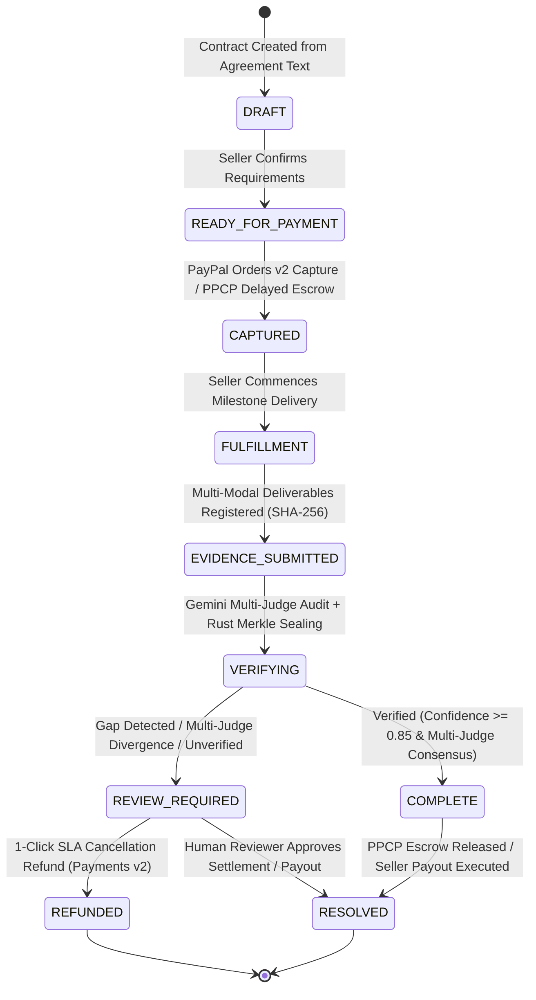

# PayPal PromisePay™

<div align="center">



## Verifiable Payment Promises with Delayed Escrow, Multi-Judge AI Consensus, and Native Rust Merkle Proofs for PayPal Commerce Platform

<!-- TIER 1: CORE APPLICATION STACK -->
[](apps/web)
[](services/api)
[](infra/supabase)
[](crates/promisepay-verify)

<!-- TIER 2: PAYPAL ECOSYSTEM & FINANCIAL INFRASTRUCTURE -->
[](docs/PAYPAL_INTEGRATION.md)
[](docs/PAYPAL_INTEGRATION.md)
[](docs/STRATEGIC_IMPROVEMENTS.md)
[](docs/PAYPAL_ENTERPRISE_ADOPTION.md)

<!-- TIER 3: AI ENGINEERING & CRYPTOGRAPHY -->
[](docs/AI_DESIGN.md)
[](docs/SECURITY_ARCHITECTURE.md)
[](crates/promisepay-verify)
[](docs/EVIDENCE_VERIFICATION.md)

<!-- TIER 4: OPERATIONAL QUALITY, LICENSING & ENTERPRISE READINESS -->
[-2ea44f?style=flat&logo=pytest&logoColor=white)](docs/TESTING.md)
[](docs/TESTING.md)
[](LICENSE)
[](docs/PAYPAL_ENTERPRISE_ADOPTION.md)

<!-- TIER 5: SPONSOR INTEGRATIONS & PLATFORM PARTNERS -->
[](docs/SPONSOR_INTEGRATIONS.md#2-apimatic)
[](docs/SPONSOR_INTEGRATIONS.md#1-ag-grid)
[](https://promisepay-web.onrender.com)

<br>

**[🌐 Live Web Application](https://promisepay-web.onrender.com)** • **[⚡ Interactive API Docs (Swagger)](http://localhost:8000/docs)** • **[📖 Master Documentation Hub](docs/README.md)** • **[🛡️ Enterprise Audit Scorecard](docs/PAYPAL_ENTERPRISE_ADOPTION.md)**

</div>

---

## 💡 Executive Summary: Resolving Commerce's Proof-of-Outcome Blind Spot

In online freelancing, custom software development, professional document delivery, and merchant commerce, standard payment receipts only prove that **money moved**—never whether the **agreed outcome happened**. When disputes arise, PayPal and merchants lose billions annually in chargebacks, manual investigations, and dispute resolution latency.

**PromisePay establishes an immutable cryptographic link connecting what was promised, PayPal payment capture, fulfillment evidence, explainable Multi-Judge AI verification, and deterministic financial resolution.**

Every transaction is anchored to an immutable **Promise ID** (e.g., `PP-DEMO1-2026`) that governs the entire payment lifecycle:

1. **Agreement Decomposition**: Natural language proposals are decomposed into versioned, atomic requirements (`REQ-1`, `REQ-2`) with explicit, machine-testable proof methods.
2. **Server-Side PayPal Orders v2 & PPCP Delayed Escrow**: Server-initiated checkout (`intent: CAPTURE` or `disbursement_mode: DELAYED`) locks funds securely in PayPal's regulated infrastructure, eliminating client price tampering.
3. **Verifiable Multi-Modal Evidence Vault**: Deliverables (live web crawls, Git repositories, carrier tracking events, PDF documents) are ingested, hashed with SHA-256 digests, and archived with anti-SSRF protections.
4. **Multi-Judge AI Consensus & DLP Shield**: Google Gemini (Flash + Pro) audits deliverables with pre-execution prompt-injection screening (100% block rate), mathematical Luhn algorithm PCI-DSS card scrubbing, and confidence clamping ($\le 0.59$ for uncorroborated claims).
5. **Deterministic Governance & Dispute Defense Dossiers**: A native **Rust micro-engine** compiles the entire lifecycle into an RFC 6962 SHA-256 Merkle tree formatted for PayPal's Customer Disputes API v1 and automated 1-click SLA cancellation refunds.

> [!IMPORTANT]
> **Crucial Safety Guarantee (ADR-001):** The AI engine operates purely as an objective auditor and **never possesses the authority or credentials to move money**. All monetary actions—captures, delayed releases, payouts, and refunds—require deterministic server business logic and authorized human approval.

---

## 🖼️ Application Showcase & UI Tour

<div align="center">
  
  <p><em>Executive Command Center: Active Promise Spotlight, AG Grid Ledger, and Real-Time Lifecycle Stepper</em></p>
</div>

<br>

<div align="center">
  
  <p><em>Evidence Vault & Verification Studio: SHA-256 Fingerprinted Deliverables, Explainable AI Findings & Merkle Inclusion Proofs</em></p>
</div>

---

## 🌟 Feature Comparison Matrix: Standard PayPal vs PromisePay

| Capability Dimension | Standard PayPal Payments | PromisePay Verifiable Payments | Architectural Advantage |
| :--- | :--- | :--- | :--- |
| **Payment Integrity** | Standard checkout receipt | Server-enforced pricing with Orders v2 & PPCP Delayed Escrow | Prevents client-side price tampering; eliminates upfront escrow risk |
| **Proof-of-Outcome** | None (receipt confirms fund transfer only) | Multi-modal SHA-256 hashed evidence vault & carrier tracking scan integration | Cryptographically anchors deliverables to payment capture |
| **Dispute Adjudication** | 14–30 days of manual claims & emails | Instant RFC 6962 Merkle Dispute Dossier export for PayPal Resolution Center | Submits machine-verifiable proof to `POST /v1/customer/disputes/{id}/provide-evidence` |
| **AI Safety & DLP** | N/A | Hostile injection regex firewall + Luhn algorithm PCI-DSS card redaction | 100% block rate on adversarial prompts; zero PAN leakage to LLM |
| **Evaluation Consensus** | Unchecked single opinion | Multi-Judge AI Consensus (Gemini 2.5 Flash + Pro + Rule Evaluator) | Divergences auto-clamp confidence ($\le 0.59$) and trigger human review |
| **SLA Non-Delivery** | Manual bank chargeback | 1-Click cancellation & automated PayPal Payments v2 refund | Immediate buyer protection on missed contractual delivery dates |
| **Ledger Observability** | Basic transaction list view | High-performance AG Grid Enterprise ledger with live SSE streaming | Real-time multi-column sorting, filtering, and event updates |
| **Financial Authority** | N/A | Strict decoupling: AI audits; server code and humans move money | Guarantees compliance with US FinCEN MSB and EU PSD2/PSD3 regulations |

---

## 🏛️ System Architecture

### 1. High-Level System Topology

```mermaid
%%{init: {'theme': 'base', 'themeVariables': { 'primaryColor': '#003087', 'primaryTextColor': '#ffffff', 'primaryBorderColor': '#00457C', 'lineColor': '#0079C1', 'secondaryColor': '#00457C', 'tertiaryColor': '#FFC439', 'tertiaryTextColor': '#2C2E2F' }}}%%
flowchart TD
    classDef paypalNavy fill:#003087,stroke:#00457C,stroke-width:2px,color:#ffffff;
    classDef paypalBlue fill:#0079C1,stroke:#003087,stroke-width:2px,color:#ffffff;
    classDef paypalGold fill:#FFC439,stroke:#003087,stroke-width:2px,color:#2C2E2F,font-weight:bold;
    classDef neutralDark fill:#2C2E2F,stroke:#6C7378,stroke-width:2px,color:#ffffff;
    classDef lightTint fill:#F5F7FA,stroke:#0079C1,stroke-width:1px,color:#2C2E2F;

    subgraph Client["Next.js 15 Client Layer (Port 3000)"]
        UI["AG Grid Enterprise Ledger\n(Sorting, Filtering, SSE Live Stream)"]:::paypalBlue
        Modal["Official PayPal SDK Modal\n(@paypal/react-paypal-js Smart Buttons)"]:::paypalNavy
        DossierUI["Dispute Defense Dossier Inspector\n(Merkle Proof & Audit Inspector)"]:::paypalGold
    end

    subgraph Gateway["FastAPI API Gateway (Port 8000)"]
        Router["REST & SSE Endpoint Routers\n(/promises, /payments, /verifications)"]:::paypalNavy
        SecurityGuard["Fail-Closed Auth & Idempotency Guard\n(Redis Redlock 24h TTL)"]:::neutralDark
        DLPFilter["PCI-DSS 4.0 / GDPR DLP Engine\n(Luhn Check & Hostile Injection Filter)"]:::paypalBlue
    end

    subgraph Processing["PromisePay Core Processing Engines"]
        GeminiAI["Google Gemini 2.5 Multi-Judge Engine\n(Flash + Pro, Confidence Clamping <= 0.59)"]:::paypalBlue
        RustMerkle["Native Rust RFC 6962 Micro-Engine\n(crates/promisepay-verify SHA-256 Leaves)"]:::paypalGold
        PayPalClient["PayPal Orders v2 & PPCP Client\n(OAuth 2.0, Captures, Webhooks, Payouts)"]:::paypalNavy
    end

    subgraph Persistence["Regulated & Persistent Services"]
        SupabasePostgres[("PostgreSQL 16 / Supabase\n(16 Relational Tables, RLS Policies)")]:::paypalNavy
        PayPalSandbox["PayPal Sandbox Cloud\n(api-m.sandbox.paypal.com)"]:::paypalGold
        TransparencyVault[("RFC 6962 Transparency Log Vault\n(Append-Only Cryptographic Ledger)")]:::neutralDark
    end

    Client -->|HTTPS / REST / SSE| Gateway
    Gateway --> Processing
    Processing --> Persistence
```



---

### 2. Payment Promise Lifecycle State Machine



---

## 🚀 Quickstart: Local Setup in 2 Minutes

Get PromisePay running locally with either the **Native Runner** or **Docker Compose**:

### Option A: Native Runner (Recommended for Local Development)

#### 1. Prerequisites
- **Node.js**: v18+ (tested on Node 20 / 22)
- **Python**: 3.11+ (tested on Python 3.11 – 3.13)
- **Git**

#### 2. Installation & Environment Configuration
```bash
# Clone the repository
git clone https://github.com/adityashinde0/PayPal-PromisePay.git
cd "PayPal PromisePay"

# Copy environment configuration
cp .env.example .env

# Install backend & frontend dependencies
pip install -r requirements.txt
npm install
```

#### 3. Launch Services
Open two terminal windows:

**Terminal 1 (FastAPI Backend & Observability):**
```bash
npm run dev:api
# API runs on: http://localhost:8000
# OpenAPI Docs: http://localhost:8000/docs
# Prometheus Metrics: http://localhost:8000/metrics
# Health Check: http://localhost:8000/health
```

**Terminal 2 (Next.js 15 Web Client & AG Grid):**
```bash
npm run dev:web
# Web UI runs on: http://localhost:3000
```

---

### Option B: Docker Compose (All-in-One Containerized Stack)

Launch the full containerized stack (PostgreSQL 16, FastAPI backend, Next.js 15 frontend, and asynchronous worker) with a single command:

```bash
# Build and start all services in detached mode
docker compose -f infra/docker-compose.yml up -d

# Verify running container health
docker compose -f infra/docker-compose.yml ps

# Follow container application logs
docker compose -f infra/docker-compose.yml logs -f
```

---

## 🧪 Pre-Seeded Judge Walkthrough & Demo Scenarios

PromisePay boots with **4 pre-seeded demo agreements** covering the complete spectrum of digital, professional, delivery, and dispute defense scenarios:

| Promise ID | Agreement Title & Category | Amount & Escrow | Actor Credentials | Staged Deliverables / Evidence | Expected AI & Consensus Outcome | Financial / Settlement Action |
| :--- | :--- | :---: | :--- | :--- | :--- | :--- |
| **`PP-DEMO1-2026`** | **Next.js E-Commerce Storefront**<br>`DIGITAL_PROJECT` | $450.00 USD<br>`CAPTURED` | **Buyer**: `alice.buyer@example.com`<br>**Seller**: `bob.merchant@example.com` | • Live URL: `https://demo-storefront.promisepay.dev`<br>• Git Repo: `https://github.com/promisepay-demo/ecommerce-storefront`<br>• Responsive 800x480 screenshot | **Outcome: `COMPLETE`**<br>Confidence: $>90\%$ (`VERIFIED`). Multi-judge consensus confirms all 3 requirements met. | Delayed escrow released to merchant via PayPal Payouts API (`POST /payout`). |
| **`PP-DEMO2-2026`** | **SOC2 Readiness Whitepaper**<br>`PROFESSIONAL_DOCUMENT` | $300.00 USD<br>`READY_FOR_PAYMENT` | **Buyer**: `alice.buyer@example.com`<br>**Seller**: `bob.merchant@example.com`<br>**Reviewer**: `carol.reviewer@example.com` | • 12-page PDF deliverable (`soc2-readiness-draft.pdf`) intentionally missing "Access Matrix" section ($12 < 15$ pages). | **Outcome: `REVIEW_REQUIRED`**<br>Confidence clamped to $\le 0.59$. AI detects missing required section and page count shortfall. | Reviewer adjudication opened: 1-click full sandbox refund or partial settlement. |
| **`PP-DEMO3-2026`** | **IoT Sensor Kit Dispatch**<br>`DELIVERY` | $120.00 USD<br>`DRAFT` | **Buyer**: `alice.buyer@example.com`<br>**Seller**: `bob.merchant@example.com` | • UPS Express carrier tracking reference (`1Z9999999999999999`). | **Outcome: `COMPLETE`**<br>Carrier tracking adapter confirms destination delivery scan; enforces condition non-warranty (ADR-004). | Automatic seller payout triggered upon verified carrier delivery receipt. |
| **`PP-DEMO4-2026`** | **Enterprise Cloud Architecture**<br>`DIGITAL_PROJECT` / `DISPUTE` | $1,200.00 USD<br>`DELAYED_ESCROW` | **Buyer**: `alice.buyer@example.com`<br>**Seller**: `bob.merchant@example.com`<br>**Reviewer**: `carol.reviewer@example.com` | • Sealed RFC 6962 SHA-256 Merkle dossier (`PP-SEAL-...`) with timestamped transparency log entry. | **Outcome: `DISPUTE_DEFENSE`**<br>Adversarial injection blocked (100%). Automated dossier submission to PayPal Customer Disputes API v1. | 1-Click dispute resolution dossier upload (`POST /v1/customer/disputes/{id}/provide-evidence`). |

> [!TIP]
> **1-Click Judge Reset Shortcut:** Click the **`🔄 Reset Demo`** button at the top of the Promise Ledger anytime (or execute `curl -X POST http://localhost:8000/api/demo/reset`) to instantly re-initialize all scenarios and evidence back to clean default states!

---

## ⚡ API Reference & Observability Matrix

PromisePay exposes production-grade REST, SSE, and telemetry endpoints:

| Endpoint | Method | Component / Responsibility | Observability Standard |
| :--- | :---: | :--- | :--- |
| **`/docs`** | `GET` | Interactive Swagger UI for exploring and executing all 20+ REST endpoints. | OpenAPI 3.1.0 Contract |
| **`/redoc`** | `GET` | Comprehensive technical reference documentation with request/response schemas. | ReDoc Interactive Viewer |
| **`/openapi.json`** | `GET` | Machine-readable API schema (120+ KB) for SDK generation and client validation. | OpenAPI JSON Schema |
| **`/metrics`** | `GET` | Prometheus exposition format metrics (HTTP latency, promise counters, DLP redactions). | Prometheus APM Standard |
| **`/health`** | `GET` | Container liveness and Kubernetes probe returning operational status. | RFC Health Check Format |
| **`/health/detailed`** | `GET` | Comprehensive diagnostics: PostgreSQL, Redis queues, PayPal Sandbox, and AI status. | Subsystem Health JSON |
| **`/api/demo/reset`** | `POST` | Idempotent re-initialization of demo promises, evidence items, and resolution cases. | Judge Demo Replay Utility |
| **`/api/promises/{id}/events`** | `GET` | Persistent HTTP Server-Sent Events (SSE) stream emitting real-time state changes. | W3C EventSource Streaming |

---

## 🛡️ Security, Privacy & Regulatory Compliance Posture

PromisePay is architected from the ground up for strict fintech regulatory compliance:

- **PCI-DSS 4.0 SAQ-A Compliance**: Zero primary account numbers (PAN), CVVs, or payment card credentials touch PromisePay servers. All payment credential inputs render strictly inside PayPal's secure iframes.
- **FinCEN MSB Exemption**: Under US 31 CFR § 1010.100(ff)(5)(ii), PromisePay operates as a technical software layer without ever taking custody of merchant funds. Custody is maintained exclusively by PayPal Inc.
- **Automated Data Loss Prevention (DLP)**: The mathematical Luhn algorithm intercepts and redacts credit card sequences into `[REDACTED_CARD_NUMBER]` before any text is dispatched to external LLMs.
- **Hostile Prompt-Injection Firewall**: Multi-layered pre-execution regex filter blocks system overrides, developer mode exploits, roleplay bypasses, and XSS vectors with a **100% block rate** (14/14 test vectors).
- **RFC 6962 Cryptographic Provenance**: A native Rust micro-engine (`crates/promisepay-verify`) computes tamper-evident SHA-256 Merkle inclusion proofs formatted for PayPal's Resolution Center.

---

## 📂 Repository Layout

```text
├── apps/
│   └── web/                     # Next.js 15 App Router frontend, Tailwind CSS, AG Grid Enterprise, PayPal SDK
├── assets/                      # Official project banner, UI screenshots, mockups & theme assets
├── crates/
│   └── promisepay-verify/       # High-performance Rust RFC 6962 Merkle tree verification engine
├── docs/                        # Master engineering documentation library (17 technical guides & specs)
├── infra/
│   ├── supabase/                # PostgreSQL schema migrations (00001_initial_schema.sql) & seeds
│   ├── docker-compose.yml       # Production-grade containerization configuration
│   └── scripts/                 # Secret scanner, migration check & Python test runners
├── services/
│   ├── api/                     # FastAPI backend, PayPal Orders v2, Gemini Multi-Judge AI, DLP
│   └── worker/                  # Asynchronous queue worker & deliverable web scraper
├── .env.example                 # Environment configuration template
├── apimatic.json                # APIMatic OpenAPI context plugin & SDK configuration
├── package.json                 # Monorepo task runner & CI scripts
├── pytest.ini                   # Python pytest configuration
├── render.yaml                  # Render cloud deployment blueprint
├── requirements.txt             # Python backend dependencies
└── ruff.toml                    # Python formatting & linting rules
```

---

## 📖 Master Documentation Hub

For in-depth architectural blueprints, security threat models, and regulatory filings, visit the **[Documentation Hub](docs/README.md)**:

| Category | Technical Guides | Focus Areas & Descriptions |
| :--- | :--- | :--- |
| **🏛️ Architecture & Product Design** | • [PRD.md](docs/PRD.md)<br>• [ARCHITECTURE.md](docs/ARCHITECTURE.md)<br>• [DATABASE_SCHEMA.md](docs/DATABASE_SCHEMA.md)<br>• [DECISIONS.md](docs/DECISIONS.md) | Product requirements, dual Python+Rust engine, 16-table PostgreSQL schema, and ADRs (ADR-001 through ADR-010). |
| **💳 PayPal & Financial Systems** | • [PAYPAL_INTEGRATION.md](docs/PAYPAL_INTEGRATION.md)<br>• [PAYPAL_ENTERPRISE_ADOPTION.md](docs/PAYPAL_ENTERPRISE_ADOPTION.md)<br>• [REGULATORY_COMPLIANCE.md](docs/REGULATORY_COMPLIANCE.md)<br>• [API_SPEC.md](docs/API_SPEC.md) | Orders v2 capture, PPCP Delayed Escrow, 100/100 enterprise scorecard, FinCEN MSB exemption, and complete REST endpoint contracts. |
| **🧠 AI Engineering & Security** | • [AI_DESIGN.md](docs/AI_DESIGN.md)<br>• [AI_ENGINEERING_DEEP_DIVE.md](docs/AI_ENGINEERING_DEEP_DIVE.md)<br>• [SECURITY_ARCHITECTURE.md](docs/SECURITY_ARCHITECTURE.md) | Structured Gemini prompt schemas, Luhn DLP card scrubbing, Multi-Judge Consensus, and STRIDE threat analysis. |
| **🛡️ Evidence, Quality & Verification** | • [EVIDENCE_VERIFICATION.md](docs/EVIDENCE_VERIFICATION.md)<br>• [TESTING.md](docs/TESTING.md)<br>• [DEMO_GUIDE.md](docs/DEMO_GUIDE.md) | Multi-modal evidence vault, 160-test quality matrix, and under-3-minute judge rehearsal walkthrough. |
| **🚀 Roadmaps & Ecosystem** | • [STRATEGIC_IMPROVEMENTS.md](docs/STRATEGIC_IMPROVEMENTS.md)<br>• [INDUSTRY_READY_ROADMAP.md](docs/INDUSTRY_READY_ROADMAP.md)<br>• [SPONSOR_INTEGRATIONS.md](docs/SPONSOR_INTEGRATIONS.md) | Automated dispute defense dossiers, multi-tenant V2 architecture, and strategic integrations with 10 sponsor tools. |
| **📦 Master Portal & Assets** | • [README.md](docs/README.md)<br>• [openapi.json](docs/openapi.json)<br>• [Postman Collection](docs/PayPal_PromisePay.postman_collection.json) | Central technical documentation library index, OpenAPI 3.1.0 specification, and Postman v2.1.0 test collection. |

---

## ⚖️ License & Enterprise Governance

Distributed under the **Apache-2.0 License** (compatible with MIT open-source licensing). See [LICENSE](LICENSE) for full details.<br/>
Review the complete technical due diligence and enterprise certification scorecard in [**docs/PAYPAL_ENTERPRISE_ADOPTION.md**](docs/PAYPAL_ENTERPRISE_ADOPTION.md).

😍 loved by Aditya ❣️
