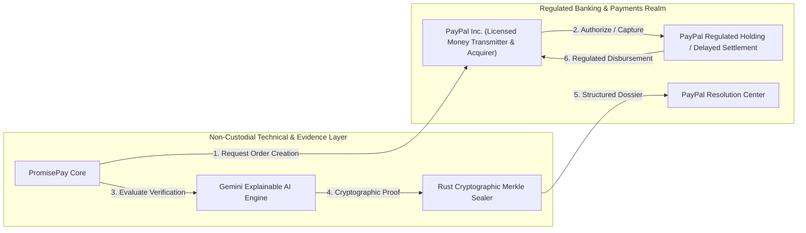

# Regulatory Compliance, Money Transmission & Platform Policies

**Document Classification:** Legal, Financial Regulations & Platform Policy Blueprint  
**Product:** PayPal PromisePay  
**Version:** 1.0.0  
**Effective Date:** November 2026  
**Applicability:** US FinCEN, State Escrow Licensing, EU PSD2/PSD3, UK FCA, and PayPal Complete Payments (PPCP) Platform Policies  

---

## 1. Executive Summary & Purpose

Modern digital commerce—including freelance development, milestone services, professional deliverables, and custom physical orders—suffers from severe trust asymmetry. Buyers fear paying upfront for non-delivery; sellers fear delivering work without guaranteed payment.

While traditional "escrow" services bridge this trust gap, holding customer funds in custody is one of the most heavily regulated activities in global finance. **PromisePay is architected from the ground up as non-custodial proof-of-outcome infrastructure, ensuring that PayPal—a regulated, licensed financial institution—retains 100% custody and execution of all monetary transactions.**

This document details the regulatory compliance architecture, licensing boundaries, PayPal marketplace rules, PCI-DSS scope minimization, and responsible AI safeguards governing the PromisePay platform.

---

## 2. Global Regulatory Landscape for Payments & Escrow

### 2.1 The United States (FinCEN & State Regulations)

In the United States, custody of commercial funds between two contracting parties triggers multiple overlapping legal frameworks:

1. **FinCEN (Financial Crimes Enforcement Network) & Bank Secrecy Act (BSA):**
   - Entities accepting and transmitting currency or funds of monetary value are classified as **Money Services Businesses (MSBs)** and **Money Transmitters** under 31 CFR § 1010.100(ff)(5).
   - Unlicensed money transmission at the federal level is a federal crime under 18 U.S. Code § 1960.
2. **State-Level Money Transmitter & Escrow Licensing (MTLs):**
   - 49 US states require independent licenses to hold or transmit customer funds.
   - States like California (Department of Financial Protection and Innovation - DFPI), New York (NYDFS), and Texas (DOB) impose statutory capital reserve requirements ($500K–$2M+ per state), surety bonding, annual audits, and comprehensive AML/BSA compliance officers.
3. **Escrow Law Exemption:**
   - Online software platforms that attempt to hold funds in internal bank accounts without an Escrow Agent License violate state escrow statutes (e.g., California Financial Code § 17000 *et seq.*).

### 2.2 European Union & United Kingdom (PSD2 / PSD3 & FCA)

1. **Payment Services Directive 2 (PSD2 / Directive 2015/2366/EU) & PSD3:**
   - Under PSD2, commercial platforms cannot act as agents for both the buyer and the seller without obtaining a Payment Institution (PI) or Electronic Money Institution (EMI) license, or using an authorized payment service provider.
   - The "Commercial Agent Exemption" has been strictly narrowed by the European Banking Authority (EBA); multi-sided platforms cannot handle payment custody under this exemption.
2. **United Kingdom Payment Services Regulations (PSRs 2017) & FCA:**
   - The Financial Conduct Authority (FCA) requires firm authorization to provide payment initiation or merchant acquisition services. Strict safeguarding rules mandate segregated accounts and client asset (CASS) protections.

---

## 3. The "Custodial Trap" vs. PromisePay's Non-Custodial Architecture

### 3.1 The Failure Mode of Typical Startups ("The Custodial Trap")
Startups often naively attempt to build escrow by:
- Collecting money into a corporate operating account via standard payment gateways.
- Holding the balance in an internal ledger database.
- Releasing payouts to sellers via ACH or bank transfer upon approval.

**Why this fails:** This violates federal money transmission laws, triggers criminal and regulatory enforcement actions, exposes the startup to full balance sheet liability, and breaches payment gateway terms of service.

### 3.2 PromisePay's Legally Compliant Division of Responsibilities



| Domain | Entity in Charge | Regulatory Status |
| :--- | :--- | :--- |
| **Payment Custody & Holding** | **PayPal Inc.** | Regulated Global Money Transmitter / Bank |
| **Card Data Handling & PCI-DSS** | **PayPal Checkout SDK v6** | Level 1 PCI-DSS Service Provider |
| **Identity & Sanctions (KYC/AML/OFAC)** | **PayPal** | Customer Due Diligence (CDD) under BSA |
| **Agreement Decomposition** | **PromisePay API** | Non-financial software data processing |
| **Evidence Provenance & Verification** | **PromisePay + Gemini AI** | Non-financial objective auditing |
| **Cryptographic Sealing & Dossier** | **PromisePay Rust Engine** | Non-repudiation mathematical hashing |
| **Final Resolution Execution** | **Human Authorized Role + PayPal** | Authorized merchant or buyer action |

---

## 4. PayPal Complete Payments (PPCP) for Marketplaces

### 4.1 Delayed Disbursement Architecture (`disbursement_mode: "DELAYED"`)

PayPal Complete Payments (PPCP) for Marketplaces enables platforms to facilitate multi-party transactions while keeping payment custody and settlement entirely within PayPal's regulated boundaries:

1. **Buyer Checkout:**
   - When the buyer checks out via `POST /v2/checkout/orders`, the payment instruction includes:
     ```json
     {
       "payment_instruction": {
         "disbursement_mode": "DELAYED",
         "platform_fees": [
           {
             "amount": { "currency_code": "USD", "value": "15.00" }
           }
         ]
       }
     }
     ```
2. **Holding Mechanism:**
   - Funds are settled into the seller's PayPal account under a **regulatory holding status**. Neither PromisePay nor the buyer ever touches the funds.
3. **Verified Outcome Release:**
   - Upon AI verification and human sign-off, PromisePay triggers PayPal's Referenced Payouts API (`/v1/payments/referenced-payouts-items`) to release the hold to the seller.

### 4.2 Partner Underwriting Requirements for Live Production
To activate PPCP Delayed Disbursement in production, a platform must complete PayPal's **Partner Onboarding & Underwriting Review**:

- **KYB (Know Your Business):** Verified corporate registration (Articles of Incorporation, EIN, Beneficial Ownership disclosures).
- **Chargeback Reserve & Risk Modeling:** Underwriting assessment of dispute rates, refund reserves, and platform liability policies.
- **Partner Referrals API:** Integration with `POST /v2/customer/partner-referrals` to onboard sellers with automated merchant verification.
- **Contractual Master Merchant Agreement:** Formal legal agreement governing marketplace platform liabilities and indemnifications.

---

## 5. Non-Custodial Milestones via Native PayPal `AUTHORIZE`

For scenarios where PPCP Marketplace approval is pending or not available, PromisePay provides an alternative non-custodial milestone mechanism using PayPal's native **Orders v2 `intent: AUTHORIZE`**:

1. **29-Day Authorization Window:**
   - PayPal allows reserving a buyer's credit card or bank funds for up to **29 days** without moving money into an account.
2. **Multi-Capture on Single Authorization:**
   - PromisePay links atomic requirements to progressive milestone captures:
     - *Milestone 1 Verified (e.g. Design Approved, 30%):* Server calls `POST /v2/payments/authorizations/{id}/capture` with `is_final_capture: false`.
     - *Milestone 2 Verified (Final Deliverable, 70%):* Server calls capture with `is_final_capture: true`.
3. **Zero Custodial Liability:**
   - Funds remain with the buyer's issuing bank until captured directly to the merchant. At no point does PromisePay take possession or create an escrow liability.

---

## 6. Information Security, Privacy & PCI-DSS Compliance

### 6.1 PCI-DSS Scope Minimization (Zero Cardholder Data)
- **PCI-DSS Level:** PromisePay operates under **SAQ-A** (Self-Assessment Questionnaire A).
- **Zero Card Handling:** No Primary Account Numbers (PAN), CVVs, expiration dates, or bank routing numbers ever enter PromisePay's servers, databases, logs, or memory.
- All checkout interfaces load PayPal's secure iframes via `@paypal/react-paypal-js` (PayPal JS SDK v6).

### 6.2 Data Loss Prevention (DLP) & PII Sanitization
Before any evidence claim, text deliverable, or promise specification is forwarded to Google Gemini or external AI models:
- **Luhn Algorithm Redaction:** Any sequence of digits matching the Luhn card check formula is immediately replaced with `[REDACTED_PAYMENT_CARD]`.
- **PII Scrubbing:** Social Security Numbers, Tax IDs, IBANs, and sensitive personal identifiers are scrubbed using regular expression filters in `promisepay_api/services/dlp.py`.
- **Strict Compliance:** Prevents accidental transmission of protected personal or financial data to LLM training endpoints, satisfying GDPR Article 25 (Data Protection by Design) and PCI-DSS Requirement 3.

---

## 7. Responsible AI Governance & Algorithmic Accountability

Financial systems demand strict explainability and safety boundaries:

1. **ADR-001 (AI Does Not Move Money):**
   - The AI engine generates structured diagnostic findings (`RequirementFinding`). It **cannot initiate, approve, or execute** payment captures, refunds, or disbursements.
2. **Deterministic Confidence Clamping:**
   - Confidence scores are mathematically bounded. If evidence is an uncorroborated text claim or provenance scanning fails, confidence is hard-capped at $\le 0.59$.
3. **Anti-Hallucination Evidence ID Validation:**
   - The engine validates that every evidence ID cited in an AI finding exists in the immutable SHA-256 evidence manifest. Hallucinated IDs are discarded immediately.
4. **Fail-Closed Outcome Policy:**
   - If prompt-injection patterns, conflicting proof, or suspicious files are detected, the system fails closed into `HUMAN_REVIEW_REQUIRED`, escalating to a human adjudicator.

---

## 8. Summary of Platform Regulatory Positions

| Requirement | Regulatory Position | PromisePay Implementation |
| :--- | :--- | :--- |
| **Escrow Licensing** | Exempt | Non-custodial; all funds held and disbursed exclusively by PayPal. |
| **Money Transmission (FinCEN/MSB)** | Exempt | Technical service provider under 31 CFR § 1010.100(ff)(5)(ii)(A). |
| **PCI-DSS Compliance** | SAQ-A | Zero card data touches infrastructure; handled by PayPal SDK. |
| **Dispute Adjudication** | Evidence Provider | Generates Merkle-sealed dossiers for PayPal Customer Disputes API. |
| **AI Decision Making** | Advisory Only | Strict human-in-the-loop governance for all financial movements. |
