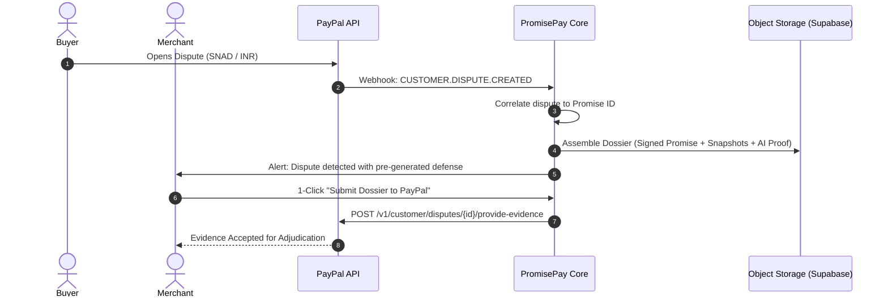

# Strategic Improvements & Product Enhancements — PromisePay

This document details the architectural and product enhancements designed to elevate PromisePay from an MVP hackathon blueprint into an enterprise-grade proof-of-outcome platform. These improvements resolve the economic game-theory dilemmas, friction barriers, and verification vulnerabilities identified during the comprehensive architecture review.

---

## 1. Executive Summary & Problem-Solution Matrix

| Challenge / Vulnerability | Root Cause in MVP | Strategic Improvement | Impact |
| :--- | :--- | :--- | :--- |
| **Post-Capture Incentive Vacuum** | Funds captured upfront (`intent: CAPTURE`); seller has no financial stake in uploading evidence. | **Phased Milestones via PayPal `AUTHORIZE`** | Sellers are motivated to upload proof to trigger milestone captures within PayPal's 29-day auth window. |
| **Seller Value Proposition / ROI** | Sellers view proof submission as an administrative burden. | **Automated "Dispute Defense Dossier"** | Gives sellers 1-click cryptographic defense evidence formatted specifically for PayPal's Resolution Center. |
| **Pre-Checkout Friction** | Manually defining atomic criteria creates cart abandonment. | **1-Click Intake (Quote/Chat/Invoice to Promise)** | AI parses pasted proposals, Slack/Upwork threads, or PDF invoices into approved promises in <10s. |
| **Evidence Tampering & Link Rot** | Live URLs can be changed, deleted, or spoofed after verification. | **Headless Immutable Snapshot Archival** | Captures DOM tree, full-page screenshot, and headers with SHA-256 hash stored in object storage. |
| **Ecosystem Depth** | Limited to Orders v2 create/capture and refund. | **PayPal Tracking & Disputes API Integration** | Automatically synchronizes shipping trackers and dispute evidence directly into PayPal's native ledger. |

---

## 2. Improvement 1: Automated "PayPal Dispute Defense Dossier"

### Problem Statement
In the standard MVP, verification results exist only inside PromisePay's internal database and AG Grid ledger. If an unhappy buyer initiates a chargeback or dispute on PayPal (*Significantly Not As Described* or *Item Not Received*), the merchant must manually gather screenshots and explain the situation to PayPal case handlers.

### Proposed Architecture & Workflow
PromisePay introduces an automated **Dispute Defense Dossier Engine**:

1. **Cryptographic Bundle Generation**:
   - When verification completes (or upon demand), PromisePay packages:
     - The agreed, signed Promise specification (versioned).
     - PayPal Order ID, Capture ID, and custom Promise ID (`PP-XXXXX-YYYY`).
     - Immutable evidence manifests with timestamps and SHA-256 checksums.
     - The explainable AI requirement-by-requirement audit breakdown.
     - Reviewer sign-off logs and immutable audit timeline.
2. **Standardized PDF / JSON Export**:
   - Generates a PDF formatted specifically to meet PayPal's Seller Protection guidelines, including clear section headings, verifiable external references, and timestamped delivery receipts.
3. **PayPal Customer Disputes API Integration (`/v1/customer/disputes`)**:
   - PromisePay listens for the `CUSTOMER.DISPUTE.CREATED` webhook.
   - When a dispute is detected on a linked `capture_id`, PromisePay automatically flags the Promise in the ledger and can provide an authenticated endpoint to push the dossier directly into PayPal's dispute thread using `POST /v1/customer/disputes/{dispute_id}/provide-evidence`.



---

## 3. Improvement 2: Phased Milestones via PayPal `AUTHORIZE` & Multi-Capture

### Problem Statement
When a payment is captured 100% upfront (`intent: CAPTURE`), bad-faith or negligent merchants have little incentive to submit rigorous evidence. Conversely, true escrow is legally complex and prohibited for non-licensed entities.

### Solution: Non-Custodial Milestones via Native PayPal Authorization
PayPal Orders v2 natively supports `intent: AUTHORIZE`, which reserves the buyer's funds for up to **29 days** without taking custody into an escrow account. PayPal allows multiple captures against a single authorization (subject to account eligibility).

### Workflow & State Machine
1. **Order Creation**:
   - Order created with `intent: AUTHORIZE`.
   - Promise requirements are grouped into milestones (e.g., *Phase 1: Design & Architecture (30%)*, *Phase 2: Working Deployment (70%)*).
2. **Buyer Approval**:
   - Buyer authorizes the total amount via PayPal Checkout.
   - PromisePay calls `POST /v2/checkout/orders/{id}/authorize` to secure the 29-day authorization hold.
3. **Milestone Progression**:
   - Merchant submits evidence for Phase 1.
   - Verification evaluates Phase 1 requirements $\rightarrow$ `COMPLETE`.
   - Buyer or authorized reviewer clicks "Release Milestone 1".
   - Server calls `POST /v2/payments/authorizations/{authorization_id}/capture` with `{ "amount": { "value": "150.00", "currency_code": "USD" }, "is_final_capture": false }`.
   - Merchant receives the 30% payout immediately from PayPal.
4. **Final Milestone**:
   - Phase 2 evidence verified $\rightarrow$ Server executes final capture with `"is_final_capture": true`.

```text
[Draft Promise] 
       │
[PayPal AUTHORIZE] (Hold on Buyer's Card/Balance, 29-day window)
       │
   ┌───┴───────────────────────────────┐
   │ Phase 1 Evidence Verified         │
   │ ➔ Partial Capture #1 (e.g., 30%)  │
   └───┬───────────────────────────────┘
       │
   ┌───┴───────────────────────────────┐
   │ Phase 2 Evidence Verified         │
   │ ➔ Final Capture #2 (Remaining 70%)│
   └───┬───────────────────────────────┘
       │
[Promise Fulfilled & Closed]
```

---

## 4. Improvement 3: Zero-Friction "1-Click Intake"

### Problem Statement
Freelancers and digital agencies will not manually type out atomic deliverables into a 5-step form for every client. Friction at creation kills checkout adoption.

### Solution: Multimodal Quote & Invoice Ingestion
PromisePay adds a frictionless entry point at `POST /promises/ingest`:

1. **Input Sources**:
   - **Text Snippet**: Raw copy-paste from an Upwork proposal, email agreement, or Slack chat.
   - **File Upload**: PDF estimate, quote, SOW (Statement of Work), or invoice.
2. **AI Extraction Pipeline**:
   - Structured JSON prompt with high-precision Pydantic validation extracts:
     - Total payable amount and currency.
     - Title and sanitized description.
     - Discrete, testable deliverables (mapped to category schemas).
     - Suggested evidence types required for each deliverable.
3. **Instant Shareable Payment Link**:
   - Generates an immediate checkout link: `https://promisepay.app/p/PP-8F72X-2026/checkout`.
   - The buyer sees the cleanly parsed deliverable checklist right above the PayPal Checkout button, ensuring crystal-clear mutual consent before payment.

---

## 5. Improvement 4: Immutable Headless Evidence Snapshots

### Problem Statement
External URLs and web services are inherently dynamic:
- A developer could deploy a site, run verification, receive `VERIFIED`, and subsequently pull down the site or push broken code.
- Checking live URLs during an audit weeks later results in 404s or changed content ("URL rot").

### Solution: Containerized Headless Capture Worker
When a URL evidence item is submitted:

1. **Headless Execution (Playwright / Chromium worker)**:
   - Worker navigates to the URL with SSRF protection (blocking `localhost`, private subnets, cloud metadata IPs `169.254.169.254`).
   - Captures:
     - Full-page viewport screenshot (`.png`).
     - Complete rendered DOM archive (`.html` / `.mhtml`).
     - HTTP response status codes, redirect chain, and TLS certificate metadata.
2. **Cryptographic Hashing & Cold Storage**:
   - Computes SHA-256 digests of the captured screenshot and DOM archive.
   - Stores assets in private, immutable Supabase/S3 object storage with the key: `evidence/{promiseId}/{evidenceId}/snapshot.mhtml`.
3. **Verification on Frozen Artifacts**:
   - The AI analyzer reads the *archived snapshot* rather than re-fetching the live web page, guaranteeing deterministic and reproducible verification over time.

---

## 6. Improvement 5: Deep Native PayPal API Expansion

To demonstrate comprehensive integration with PayPal's developer ecosystem, PromisePay extends beyond standard Checkout into two specialized PayPal APIs:

### A. PayPal Package Tracking API (`/v1/shipping/trackers`)
For physical and logistics promises:
- When a merchant submits a tracking number and carrier name (e.g., FedEx, UPS, USPS):
  - PromisePay validates the tracking format.
  - Automatically invokes `POST /v1/shipping/trackers` to register the shipment directly against the PayPal transaction.
  - Ensures the merchant is eligible for PayPal's official Seller Protection for physical goods without requiring double-entry in the PayPal Dashboard.

### B. PayPal Partner Referrals / Commerce Platform
- Multi-merchant onboarding via `POST /v2/customer/partner-referrals`.
- Allows agencies and marketplaces to integrate PromisePay as a certified platform partner, where merchants connect their own PayPal accounts via seamless OAuth onboarding.

---

## 7. Implementation Roadmap & Priority Matrix

| Phase | Feature | Effort | Hackathon Impact |
| :--- | :--- | :--- | :--- |
| **P1** | **1-Click Intake (Text/PDF Quote to Promise)** | Low (FastAPI + LLM parser) | **High**: Dazzles in the 3-minute video demo by turning a messy email into a working PayPal checkout in seconds. |
| **P1** | **Dispute Defense Dossier (Exportable PDF/JSON)** | Medium (Report generation) | **High**: Directly addresses PayPal's core business problem (dispute management & seller trust). |
| **P2** | **Headless Evidence Snapshotting** | Medium (Playwright worker + storage) | **High**: Solves the technical credibility question regarding link rot and URL tampering. |
| **P2** | **Milestone Authorization Flow (`intent: AUTHORIZE`)** | Medium (Orders v2 config + partial captures) | **Medium**: Proves sophisticated use of PayPal payment rails beyond simple capture. |
| **P3** | **PayPal Disputes & Tracking API Sync** | Medium (Additional endpoints & webhooks) | **Medium**: Strengthens institutional ecosystem alignment for commercial readiness. |

