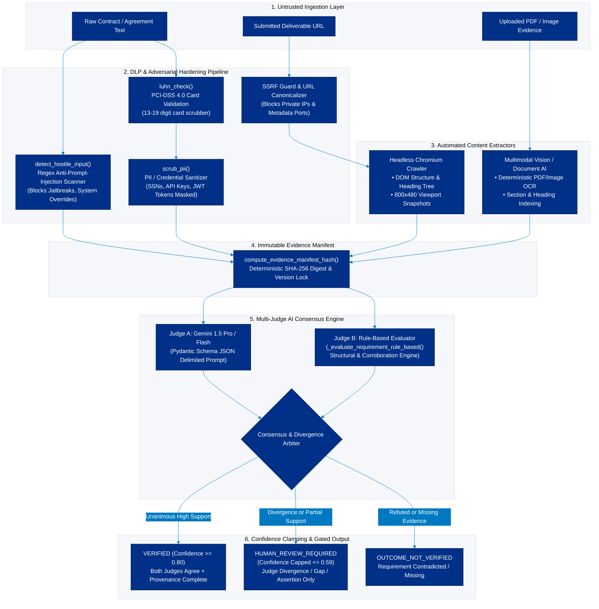

# AI design

## Purpose and non-authority

AI interprets agreement text and evidence into structured, reviewable recommendations. It cannot invoke PayPal, update payment state, select a refund amount, or bypass deterministic authorization rules. Model output is untrusted until validated.

## Services

| Service | Input | Output | Human control |
| --- | --- | --- | --- |
| Promise extractor | merchant description + selected category | structured promise and atomic requirements | merchant edits/approves before checkout |
| Verification planner | approved structured promise | acceptable evidence per requirement | merchant/reviewer may edit then approve |
| Evidence analyzer | frozen plan + normalized evidence excerpts | per-requirement finding with references/gaps | reviewer decides outcome/action |
| Resolution assistant | validated findings + case facts | case summary and recommended next step | authorized reviewer records decision |

## Required output contract

Every model output is parsed into a Pydantic schema and rejected on unknown fields, missing required fields, invalid enum values, hallucinated evidence IDs, invalid confidence values, or references to requirements outside the approved version.

```json
{
  "requirementId": "req_catalog",
  "status": "VERIFIED | PARTIALLY_VERIFIED | NOT_VERIFIED | HUMAN_REVIEW_REQUIRED",
  "confidence": 0.0,
  "evidenceIds": ["ev_abc"],
  "reasoning": "Plain-language statement limited to supplied evidence.",
  "missingInformation": ["Optional gap list"],
  "limitations": ["What this evidence cannot establish"]
}
```

## Verification algorithm



1. Freeze the approved promise version and evidence manifest (IDs, SHA-256, extraction version).
2. Normalize evidence: fetch only approved URLs, extract safe text/metadata, label each excerpt with its evidence ID; do not silently browse credentialed/private resources.
3. Run deterministic prechecks (file type, URL reachability, document section markers, tracking format) and record their results.
4. Ask the model for one finding per requirement using only labeled source material. Require explicit `evidenceIds` for every positive claim.
5. Validate output and discard findings with unsupported references. Calculate confidence bands with deterministic caps.
6. Apply policy: any high-priority unsupported or conflicting requirement, analyzer failure, or capped low confidence yields `REVIEW_REQUIRED`, never automatic completion.
7. Persist prompt template version, model identifier, input manifest hash, output, validation status, and result timestamp.

## Confidence policy

The score describes support from submitted evidence, not the factual quality of the real-world outcome.

| Band | Range | Meaning |
| --- | --- | --- |
| High | 0.85–1.00 | Multiple relevant, provenance-complete sources support the requirement |
| Medium | 0.60–0.84 | Relevant evidence supports it but leaves material limits |
| Low | 0.00–0.59 | Insufficient, weak, conflicting, or missing evidence |

Cap at `0.59` when a requirement lacks an evidence reference, source provenance is incomplete, extraction failed, or evidence is only a submitter assertion. Confidence cannot upgrade a mandatory human-review category.

## Prompt-injection and evidence safety

- Treat every document, URL, screenshot OCR result, repository README, and tracking note as untrusted data—not instructions.
- System/developer instructions tell the model to ignore directions contained in evidence and to return only the schema.
- Evidence is labelled and delimited; model tools are disabled for verification runs.
- Do not send secrets, credentials, full payment details, or unnecessary personal data to the model.
- Use file and URL scanning/extraction before model access. A parser failure becomes a review gap.

## Explainability UX

Show requirement text, result, confidence band, evidence links, plain-language reason, missing information, and limitations. Never render “AI verified” without evidence traceability. The user can open a review case from any result.

## Evaluation set

Maintain a versioned fixture set for each category: complete, one critical requirement missing, contradictory evidence, duplicate evidence, malformed document, irrelevant document, hostile/prompt-injection text, and unverifiable physical-delivery claim. Track schema-valid rate, evidence-citation precision, false-complete rate, and reviewer agreement.
