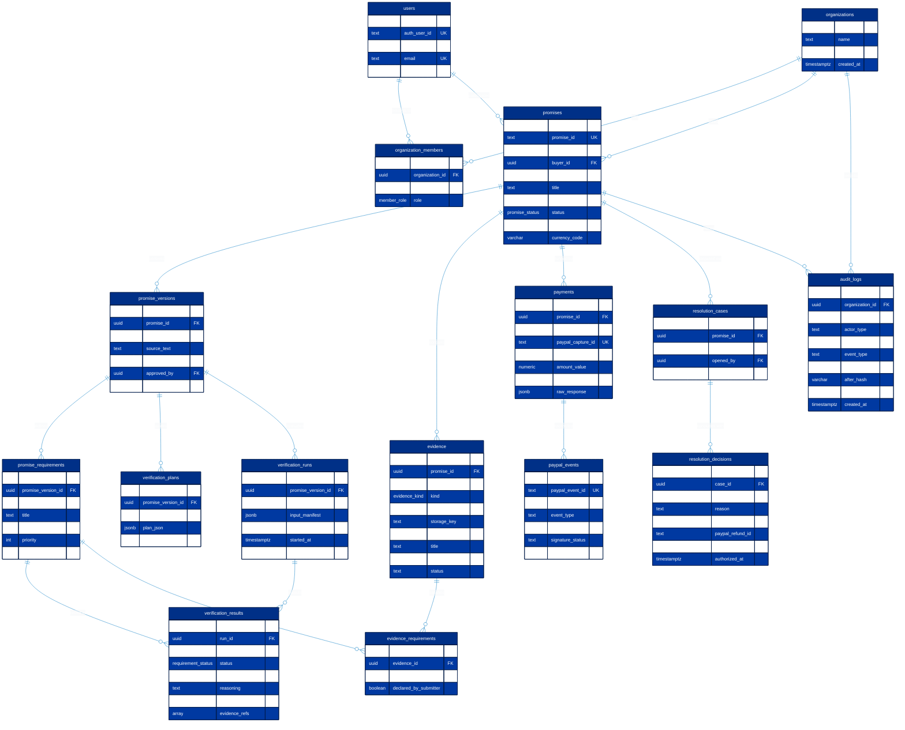

# Database schema

PostgreSQL via Supabase. Uses UUID primary keys, `timestamptz` for all temporal timestamps, `numeric(15,2)` for financial values, check constraints for data invariants, 9 custom ENUM types for state machines, and automated migrations. Store ISO 4217 currency with every monetary amount.

## Entity-Relationship Diagram (ERD)

The complete 16-table relational schema models organizations, promises, versions, requirements, evidence, PayPal payments, webhooks, verification runs, resolution cases, and append-only audit ledgers:

## Custom ENUM types

The database defines 9 custom enumerated types to guarantee strict compile-time and runtime state validation:

| Enum Name | Enumerated Values | Usage Domain |
| --- | --- | --- |
| `promise_status` | `DRAFT`, `READY_FOR_PAYMENT`, `PAYMENT_PENDING`, `PAID`, `FULFILLMENT`, `EVIDENCE_SUBMITTED`, `VERIFYING`, `COMPLETE`, `REVIEW_REQUIRED`, `OUTCOME_NOT_VERIFIED`, `RESOLVED`, `CANCELLED` | Lifecycle state of a payment promise |
| `payment_state` | `NOT_STARTED`, `ORDER_CREATED`, `APPROVED`, `CAPTURED`, `FAILED`, `CANCELLED`, `REFUND_PENDING`, `REFUNDED` | PayPal Orders v2 / Payments v2 state |
| `member_role` | `BUYER`, `SELLER`, `REVIEWER`, `ADMIN` | Organization membership and RBAC permissions |
| `promise_category` | `DIGITAL_PROJECT`, `PROFESSIONAL_DOCUMENT`, `DELIVERY` | Templated deliverable evaluation categories |
| `verification_status` | `PENDING`, `RUNNING`, `COMPLETE`, `REVIEW_REQUIRED`, `OUTCOME_NOT_VERIFIED`, `FAILED` | Asynchronous worker verification job status |
| `requirement_status` | `PENDING`, `VERIFIED`, `PARTIALLY_VERIFIED`, `UNSUPPORTED`, `CONTRADICTED`, `REVIEW_REQUIRED` | Requirement-level evaluation outcome |
| `evidence_kind` | `URL_SNAPSHOT`, `DOCUMENT_FILE`, `IMAGE_SCREENSHOT`, `GIT_REPOSITORY`, `TRACKING_REFERENCE` | Ingested evidence deliverable format |
| `resolution_case_status` | `NONE`, `OPEN`, `DECISION_RECORDED`, `ACTION_PENDING`, `CLOSED` | Human resolution case management lifecycle |
| `resolution_decision_type` | `APPROVE_FULFILLMENT`, `APPROVE_REFUND`, `PARTIAL_REFUND`, `REJECT_CLAIM`, `REQUEST_ADDITIONAL_EVIDENCE` | Authorized arbiter / reviewer decision actions |

## 16-Table Relational Schema Catalog

### 1. `users`
Authenticated application users and system actors.
- `id` (`UUID`, PK, default `gen_random_uuid()`): Unique user identifier.
- `auth_user_id` (`TEXT`, UNIQUE, nullable): External Supabase Auth user ID.
- `display_name` (`TEXT`, NOT NULL): Full human-readable user name.
- `email` (`TEXT`, UNIQUE, NOT NULL): Contact and notification email address.
- `avatar_url` (`TEXT`, nullable): Profile avatar image URI.
- `created_at` (`TIMESTAMPTZ`, NOT NULL, default `NOW()`): Record creation timestamp.
- `updated_at` (`TIMESTAMPTZ`, NOT NULL, default `NOW()`): Last update timestamp.

### 2. `organizations`
Multi-tenant organizational boundary for promises, payments, and audit ledgers.
- `id` (`UUID`, PK, default `gen_random_uuid()`): Unique organization tenant ID.
- `name` (`TEXT`, NOT NULL): Organization display name.
- `slug` (`TEXT`, UNIQUE, NOT NULL): URL-safe tenant identifier.
- `created_at` (`TIMESTAMPTZ`, NOT NULL, default `NOW()`): Tenant creation timestamp.
- `updated_at` (`TIMESTAMPTZ`, NOT NULL, default `NOW()`): Tenant update timestamp.

### 3. `organization_members`
RBAC association linking users to organizations with assigned roles.
- `id` (`UUID`, PK, default `gen_random_uuid()`): Membership join identifier.
- `organization_id` (`UUID`, NOT NULL, FK `organizations.id` ON DELETE CASCADE): Tenant reference.
- `user_id` (`UUID`, NOT NULL, FK `users.id` ON DELETE CASCADE): User reference.
- `role` (`member_role`, NOT NULL, default `'BUYER'`): Assigned RBAC role (`BUYER`, `SELLER`, `REVIEWER`, `ADMIN`).
- `created_at` (`TIMESTAMPTZ`, NOT NULL, default `NOW()`): Role assignment timestamp.
- *Constraint*: `UNIQUE (organization_id, user_id)`.

### 4. `promises`
Core lifecycle root for conditional payment agreements.
- `id` (`UUID`, PK, default `gen_random_uuid()`): Internal database primary key.
- `promise_id` (`TEXT`, UNIQUE, NOT NULL): Public-facing immutable promise ID (`PP-XXXX-YYYY`).
- `organization_id` (`UUID`, NOT NULL, FK `organizations.id` ON DELETE CASCADE): Owning tenant.
- `buyer_id` (`UUID`, nullable, FK `users.id` ON DELETE SET NULL): Agreement buyer user reference.
- `seller_id` (`UUID`, nullable, FK `users.id` ON DELETE SET NULL): Agreement seller user reference.
- `title` (`TEXT`, NOT NULL): Sanitized promise title.
- `category` (`promise_category`, NOT NULL): Evaluation category domain.
- `status` (`promise_status`, NOT NULL, default `'DRAFT'`): Current lifecycle state.
- `amount_value` (`NUMERIC(15,2)`, NOT NULL): Agreed total payment value (must be $> 0$).
- `currency_code` (`VARCHAR(3)`, NOT NULL, default `'USD'`): ISO 4217 three-letter currency.
- `created_at` (`TIMESTAMPTZ`, NOT NULL, default `NOW()`): Initial creation timestamp.
- `updated_at` (`TIMESTAMPTZ`, NOT NULL, default `NOW()`): Last state transition timestamp.
- *Constraint*: `CHECK (amount_value > 0)`.
- *Constraint*: `CHECK (promise_id ~ '^PP-[A-Z0-9]{4,12}-\d{4}$')`.

### 5. `promise_versions`
Immutable, approved contract snapshots and requirement freezes.
- `id` (`UUID`, PK, default `gen_random_uuid()`): Version primary key.
- `promise_id` (`UUID`, NOT NULL, FK `promises.id` ON DELETE CASCADE): Parent promise reference.
- `version` (`INT`, NOT NULL, default `1`): Monotonically increasing version number.
- `source_text` (`TEXT`, NOT NULL): Original unprocessed agreement narrative.
- `structured_promise` (`JSONB`, NOT NULL, default `'{}'`): Pydantic-validated promise schema.
- `approved_by` (`UUID`, nullable, FK `users.id` ON DELETE SET NULL): Approving user reference.
- `approved_at` (`TIMESTAMPTZ`, nullable): Explicit approval timestamp.
- `created_at` (`TIMESTAMPTZ`, NOT NULL, default `NOW()`): Version lock timestamp.
- *Constraint*: `UNIQUE (promise_id, version)`.

### 6. `promise_requirements`
Atomic, measurable deliverable conditions extracted from approved versions.
- `id` (`UUID`, PK, default `gen_random_uuid()`): Requirement primary key.
- `promise_version_id` (`UUID`, NOT NULL, FK `promise_versions.id` ON DELETE CASCADE): Owning version.
- `key` (`TEXT`, NOT NULL): Requirement key (e.g., `REQ-1`, `REQ-2`).
- `title` (`TEXT`, NOT NULL): Short summary of required outcome.
- `description` (`TEXT`, NOT NULL): Full specification of requirement acceptance criteria.
- `priority` (`INT`, NOT NULL, default `1`): Priority level ($1 = \text{Critical}$).
- `verification_method` (`TEXT`, NOT NULL): Defined audit method (e.g., `LIVE_CRAWL`, `OCR`, `CARRIER_TRACKING`).
- `created_at` (`TIMESTAMPTZ`, NOT NULL, default `NOW()`): Creation timestamp.
- *Constraint*: `UNIQUE (promise_version_id, key)`.

### 7. `verification_plans`
Structured criteria and acceptable evidence matrices produced by AI and confirmed by humans.
- `id` (`UUID`, PK, default `gen_random_uuid()`): Verification plan primary key.
- `promise_version_id` (`UUID`, NOT NULL, FK `promise_versions.id` ON DELETE CASCADE): Version reference.
- `status` (`TEXT`, NOT NULL, default `'APPROVED'`): Plan approval status.
- `plan_json` (`JSONB`, NOT NULL, default `'{}'`): Matrix of acceptable evidence types per requirement.
- `model_metadata` (`JSONB`, NOT NULL, default `'{}'`): Gemini model version and temperature used in planning.
- `created_at` (`TIMESTAMPTZ`, NOT NULL, default `NOW()`): Plan creation timestamp.

### 8. `evidence`
Immutable records of submitted deliverables, repository references, and file uploads.
- `id` (`UUID`, PK, default `gen_random_uuid()`): Evidence primary key.
- `promise_id` (`UUID`, NOT NULL, FK `promises.id` ON DELETE CASCADE): Target promise reference.
- `uploader_id` (`UUID`, nullable, FK `users.id` ON DELETE SET NULL): Submitting user reference.
- `kind` (`evidence_kind`, NOT NULL): Evidence deliverable type (`URL_SNAPSHOT`, `DOCUMENT_FILE`, etc.).
- `source_uri` (`TEXT`, nullable): External URL or origin reference.
- `storage_key` (`TEXT`, nullable): Encrypted Supabase Storage object path.
- `sha256` (`VARCHAR(64)`, NOT NULL): Cryptographic SHA-256 digest of original artifact.
- `title` (`TEXT`, NOT NULL): Evidence title or filename.
- `summary` (`TEXT`, nullable): Submitter-provided delivery notes.
- `provenance_json` (`JSONB`, NOT NULL, default `'{}'`): Capture metadata, HTTP headers, carrier timestamps.
- `status` (`TEXT`, NOT NULL, default `'SUBMITTED'`): Processing status (`SUBMITTED`, `SCANNED`, `REDACTED`).
- `created_at` (`TIMESTAMPTZ`, NOT NULL, default `NOW()`): Submission timestamp.

### 9. `evidence_requirements`
Many-to-many junction mapping evidence deliverables to the requirements they satisfy.
- `id` (`UUID`, PK, default `gen_random_uuid()`): Junction primary key.
- `evidence_id` (`UUID`, NOT NULL, FK `evidence.id` ON DELETE CASCADE): Evidence item reference.
- `requirement_id` (`UUID`, NOT NULL, FK `promise_requirements.id` ON DELETE CASCADE): Requirement reference.
- `declared_by_submitter` (`BOOLEAN`, NOT NULL, default `true`): Submitter attribution flag.
- `created_at` (`TIMESTAMPTZ`, NOT NULL, default `NOW()`): Association timestamp.
- *Constraint*: `UNIQUE (evidence_id, requirement_id)`.

### 10. `payments`
PayPal payment transactions, Order IDs, and Capture state linkages.
- `id` (`UUID`, PK, default `gen_random_uuid()`): Payment primary key.
- `promise_id` (`UUID`, NOT NULL, FK `promises.id` ON DELETE CASCADE): Associated promise.
- `paypal_order_id` (`TEXT`, UNIQUE, NOT NULL): PayPal Orders v2 resource ID (`5O190127...`).
- `paypal_capture_id` (`TEXT`, UNIQUE, nullable): PayPal Payments v2 capture ID (`7AB12345...`).
- `state` (`payment_state`, NOT NULL, default `'ORDER_CREATED'`): Current payment state.
- `amount_value` (`NUMERIC(15,2)`, NOT NULL): Server-calculated captured amount.
- `currency_code` (`VARCHAR(3)`, NOT NULL, default `'USD'`): ISO 4217 currency.
- `idempotency_key` (`TEXT`, nullable): Client request idempotency token.
- `raw_response` (`JSONB`, default `'{}'`): Sanitized PayPal API response payload.
- `created_at` (`TIMESTAMPTZ`, NOT NULL, default `NOW()`): Order creation timestamp.
- `updated_at` (`TIMESTAMPTZ`, NOT NULL, default `NOW()`): Last state transition timestamp.
- *Constraint*: `CHECK (amount_value > 0)`.

### 11. `paypal_events`
Webhook delivery ledger guaranteeing idempotent, deduplicated event processing.
- `id` (`UUID`, PK, default `gen_random_uuid()`): Webhook receipt primary key.
- `paypal_event_id` (`TEXT`, UNIQUE, NOT NULL): PayPal webhook event identifier (`WH-...`).
- `payment_id` (`UUID`, nullable, FK `payments.id` ON DELETE SET NULL): Correlated payment reference.
- `event_type` (`TEXT`, NOT NULL): Event name (e.g., `PAYMENT.CAPTURE.COMPLETED`).
- `payload_digest` (`VARCHAR(64)`, NOT NULL): SHA-256 hash of raw webhook payload.
- `signature_status` (`TEXT`, NOT NULL, default `'VERIFIED'`): Cryptographic postback verification status.
- `raw_payload` (`JSONB`, NOT NULL, default `'{}'`): Sanitized webhook payload payload.
- `processed_at` (`TIMESTAMPTZ`, NOT NULL, default `NOW()`): Processing timestamp.

### 12. `verification_runs`
Reproducible audit executions evaluating evidence against a frozen promise version.
- `id` (`UUID`, PK, default `gen_random_uuid()`): Run primary key.
- `promise_version_id` (`UUID`, NOT NULL, FK `promise_versions.id` ON DELETE CASCADE): Frozen version evaluated.
- `status` (`verification_status`, NOT NULL, default `'PENDING'`): Overall execution status.
- `input_manifest` (`JSONB`, NOT NULL, default `'{}'`): Frozen snapshot of evidence IDs and hashes.
- `model_metadata` (`JSONB`, NOT NULL, default `'{}'`): Multi-judge configuration (Gemini Flash + Pro + rules).
- `started_at` (`TIMESTAMPTZ`, NOT NULL, default `NOW()`): Run start timestamp.
- `completed_at` (`TIMESTAMPTZ`, nullable): Run termination timestamp.

### 13. `verification_results`
Atomic, requirement-level evaluation findings produced by the Multi-Judge Consensus Engine.
- `id` (`UUID`, PK, default `gen_random_uuid()`): Result primary key.
- `run_id` (`UUID`, NOT NULL, FK `verification_runs.id` ON DELETE CASCADE): Parent verification run.
- `requirement_id` (`UUID`, NOT NULL, FK `promise_requirements.id` ON DELETE CASCADE): Requirement evaluated.
- `status` (`requirement_status`, NOT NULL, default `'PENDING'`): Evaluated status (`VERIFIED`, `REVIEW_REQUIRED`, etc.).
- `confidence` (`NUMERIC(3,2)`, NOT NULL): Evaluated confidence score clamped between $0.00$ and $1.00$.
- `reasoning` (`TEXT`, NOT NULL): Plain-language justification citing evidence findings.
- `missing_information` (`TEXT[]`, default `'{}'`): Explicit list of unaddressed requirement gaps.
- `evidence_refs` (`UUID[]`, default `'{}'`): Array of verified evidence item UUIDs.
- `created_at` (`TIMESTAMPTZ`, NOT NULL, default `NOW()`): Result creation timestamp.
- *Constraint*: `CHECK (confidence >= 0.00 AND confidence <= 1.00)`.

### 14. `resolution_cases`
Human review and dispute arbitration workspace records.
- `id` (`UUID`, PK, default `gen_random_uuid()`): Resolution case primary key.
- `promise_id` (`UUID`, NOT NULL, FK `promises.id` ON DELETE CASCADE): Disputed promise reference.
- `status` (`resolution_case_status`, NOT NULL, default `'OPEN'`): Case status (`OPEN`, `DECISION_RECORDED`, etc.).
- `opened_by` (`UUID`, nullable, FK `users.id` ON DELETE SET NULL): Initiating user reference.
- `verification_run_id` (`UUID`, nullable, FK `verification_runs.id` ON DELETE SET NULL): Cited verification run.
- `created_at` (`TIMESTAMPTZ`, NOT NULL, default `NOW()`): Case opening timestamp.
- `updated_at` (`TIMESTAMPTZ`, NOT NULL, default `NOW()`): Last case activity timestamp.

### 15. `resolution_decisions`
Authorized human business decisions closing a case or directing financial actions.
- `id` (`UUID`, PK, default `gen_random_uuid()`): Decision primary key.
- `case_id` (`UUID`, NOT NULL, FK `resolution_cases.id` ON DELETE CASCADE): Parent case reference.
- `decision` (`resolution_decision_type`, NOT NULL): Formal decision type (`APPROVE_FULFILLMENT`, `APPROVE_REFUND`, etc.).
- `reason` (`TEXT`, NOT NULL): Mandatory human-authored factual justification.
- `refund_amount` (`NUMERIC(15,2)`, nullable): Permitted refund amount if refund is authorized.
- `paypal_refund_id` (`TEXT`, nullable): PayPal Payments v2 refund identifier (`9CD...`).
- `decided_by` (`UUID`, nullable, FK `users.id` ON DELETE SET NULL): Authorized reviewer user ID.
- `authorized_at` (`TIMESTAMPTZ`, NOT NULL, default `NOW()`): Decision authorization timestamp.
- *Constraint*: `CHECK (refund_amount IS NULL OR refund_amount >= 0)`.

### 16. `audit_logs`
Cryptographically hash-chained, append-only audit ledger for compliance and dispute defense dossiers.
- `id` (`UUID`, PK, default `gen_random_uuid()`): Audit log primary key.
- `organization_id` (`UUID`, NOT NULL, FK `organizations.id` ON DELETE CASCADE): Tenant reference.
- `promise_id` (`UUID`, nullable, FK `promises.id` ON DELETE CASCADE): Related promise reference.
- `actor_type` (`TEXT`, NOT NULL): Actor category (`USER`, `REVIEWER`, `PAYPAL_WEBHOOK`, `AI_VERIFIER`).
- `actor_id` (`TEXT`, NOT NULL): Actor identifier or user UUID.
- `event_type` (`TEXT`, NOT NULL): Audit event name (e.g., `PAYMENT_CAPTURED`, `MERKLE_ROOT_SEALED`).
- `before_hash` (`VARCHAR(64)`, nullable): SHA-256 digest of record prior to mutation.
- `after_hash` (`VARCHAR(64)`, nullable): SHA-256 digest of record following mutation.
- `metadata` (`JSONB`, NOT NULL, default `'{}'`): Detailed event context and telemetry attributes.
- `created_at` (`TIMESTAMPTZ`, NOT NULL, default `NOW()`): Immutable record insertion timestamp.

## Performance & Lookup Index Catalog

The database maintains 12 B-tree indexes ensuring sub-millisecond query latency across ledger filtering, webhook reconciliation, and audit timeline lookups:

| Index Name | Target Table | Indexed Columns | Optimization Purpose |
| --- | --- | --- | --- |
| `idx_promises_org_status` | `promises` | `(organization_id, status)` | Fast AG Grid ledger filtering by tenant and promise state |
| `idx_promises_promise_id` | `promises` | `(promise_id)` | O(1) public promise lookup (`PP-XXXX-YYYY`) |
| `idx_promise_versions_promise_id` | `promise_versions` | `(promise_id)` | Efficient retrieval of all version snapshots for a promise |
| `idx_payments_promise_id` | `payments` | `(promise_id)` | Fast lookup of payment status from promise context |
| `idx_payments_paypal_order_id` | `payments` | `(paypal_order_id)` | Instant order-to-promise resolution during capture execution |
| `idx_paypal_events_event_id` | `paypal_events` | `(paypal_event_id)` | Zero-latency webhook deduplication and idempotency check |
| `idx_evidence_promise_id` | `evidence` | `(promise_id)` | Fast retrieval of evidence items during manifest compilation |
| `idx_verification_runs_version_id` | `verification_runs` | `(promise_version_id)` | Verification run history retrieval per promise version |
| `idx_verification_results_run_id` | `verification_results` | `(run_id)` | Quick assembly of atomic requirement outcomes for a run |
| `idx_resolution_cases_promise_id` | `resolution_cases` | `(promise_id)` | Dispute and resolution case lookup per promise |
| `idx_audit_logs_promise_id` | `audit_logs` | `(promise_id)` | Fast compilation of chronological promise audit trails |
| `idx_audit_logs_created_at` | `audit_logs` | `(created_at DESC)` | High-throughput compliance reporting and telemetry queries |

## Row-Level Security (RLS) Policies

All 16 relational tables have Row-Level Security (`ALTER TABLE ... ENABLE ROW LEVEL SECURITY`) activated. Tenant data isolation is strictly enforced at the database layer using two policy categories:

### 1. Service-Role Execution Policies
The backend FastAPI application connects using the privileged `service_role` connection to execute validated operations, automated worker jobs, and webhook reconciliation:
- Every table has a `service_role_bypass_*` policy permitting `ALL` operations `TO service_role USING (true) WITH CHECK (true)`.
- The `service_role` credential is kept strictly on the backend and is never exposed to browser clients.

### 2. Multi-Tenant Authenticated Isolation Policies
Direct authenticated requests evaluate JWT claims against the owning organization context:
- `org_members_isolation`: Grants `SELECT` on `organization_members` only when `organization_id` matches `request.jwt.claims ->> 'org_id'`.
- `org_promises_isolation`: Enforces read/write tenant boundaries on `promises` via `organization_id = (jwt.claims ->> 'org_id')::uuid`.
- `org_payments_isolation`: Restricts `payments` access to payments linked to promises within the caller's organization.
- `org_evidence_isolation`: Restricts `evidence` inspection and downloads to promises within the caller's tenant.
- `org_resolution_cases_isolation`: Isolates case management workspaces to the owning tenant.
- `org_audit_logs_isolation`: Restricts compliance audit log queries strictly to the caller's organization.

## Retention and Privacy Guarantees

PromisePay enforces strict data retention and privacy hygiene:
- Excerpts and sanitized findings are stored separately from original deliverable files.
- Original binary uploads are stored in private Supabase Storage buckets with server-generated, organization-scoped keys.
- Application logs never contain raw evidence binaries, client secrets, bearer tokens, or sensitive webhook authorization headers.
- Cryptographic SHA-256 digests and RFC 6962 Merkle tree proofs provide mathematically verifiable tamper-evidence while allowing original file contents to be safely expunged per GDPR / CCPA right-to-be-forgotten mandates.
