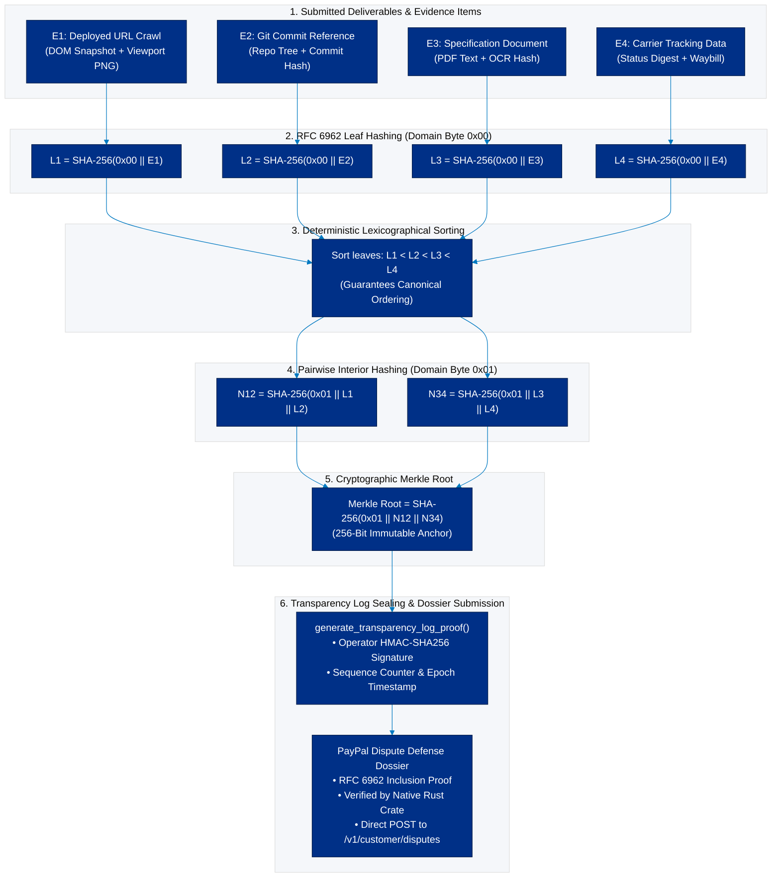

# Evidence verification

## Evidence is support, not a guarantee

PromisePay assesses whether supplied evidence supports defined requirements. It does not certify the quality, legality, ownership, security, or physical condition of a product/service. Evidence is never proof merely because a seller uploaded it.

## Evidence model

Each item records:

- `evidenceId`, promise ID, version, submitter and role;
- type (`live_url`, `repository`, `screenshot`, `document`, `tracking_reference`, `delivery_confirmation`, `metadata`);
- original source/reference and a canonicalized safe form;
- received time, optional claimed occurrence time, SHA-256 (files), content/extraction version;
- declared related requirements, provenance completeness, scanner/extraction status, and immutable storage key.

## Category plans

| Category | Requirement | Evidence that can support it | Cannot establish |
| --- | --- | --- | --- |
| Digital project | deployed responsive website | reachable live URL, multi-viewport screenshots, repository | production resilience, accessibility conformance, security, ownership |
| Digital project | authentication/cart | recorded functional path, live URL, repository code | real-user reliability or payment capability |
| Document | named/required sections | uploaded document and extracted headings/text | legal/factual/professional adequacy |
| Delivery | dispatch/delivery status | tracking reference/status, carrier/merchant confirmation | item condition, correct contents, recipient identity beyond submitted data |

## Verification statuses

- `VERIFIED`: cited evidence sufficiently supports the specific requirement within stated limits.
- `PARTIALLY_VERIFIED`: meaningful but incomplete support; UI identifies the gap.
- `NOT_VERIFIED`: submitted evidence does not support the requirement.
- `HUMAN_REVIEW_REQUIRED`: ambiguity, conflict, safety boundary, parsing failure, or a claim requiring judgment.

The overall mapping is deterministic:

- `COMPLETE` only if all mandatory requirements are `VERIFIED` or policy-approved partial results and no safety exception exists.
- `REVIEW_REQUIRED` for conflict, missing mandatory evidence, partial/high-risk findings, low confidence, or run failure.
- `OUTCOME_NOT_VERIFIED` only where policy allows a clear evidence deficiency; it remains a recommendation, not a finding of fault.

## Provenance checks

1. Authenticate and authorize submitter.
2. Validate MIME type, byte size, URL scheme/hostname policy, and tracking format.
3. Scan file and compute checksum before extraction.
4. Canonicalize URLs, prevent SSRF/private-network fetches, and retain redirect chain metadata.
5. Timestamp receipt; distinguish system-derived metadata from seller claims.
6. Link source to requirements without implying verification.
7. Freeze evidence manifest for a verification run so later uploads cannot revise its result.

## Human review triggers

- Evidence claims physical condition or delivery that is not independently demonstrable.
- Requirement is legal, medical, financial, safety-critical, subjective, or unusually consequential.
- Sources conflict, are inaccessible, are forged/suspicious, or contain prompt-injection content.
- Evidence extraction fails, provenance is incomplete, or model citations are invalid.
- A user disputes a result or a payment action might follow.

## Explainability record

An explanation includes requirement text/version, evidence IDs and permitted links, machine and deterministic checks, model/prompt/extractor versions, confidence band, limitations, missing inputs, reviewer decision, and timestamps. Evidence previews should show redaction state and access restrictions.
